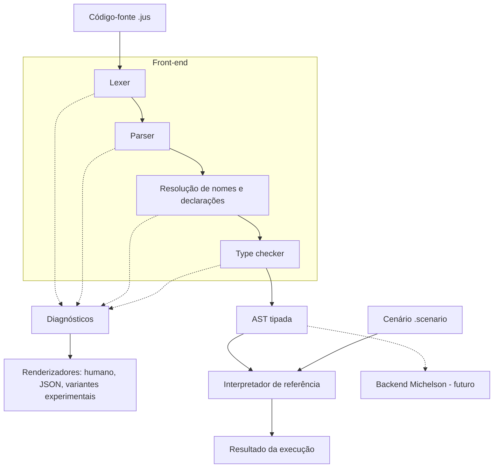
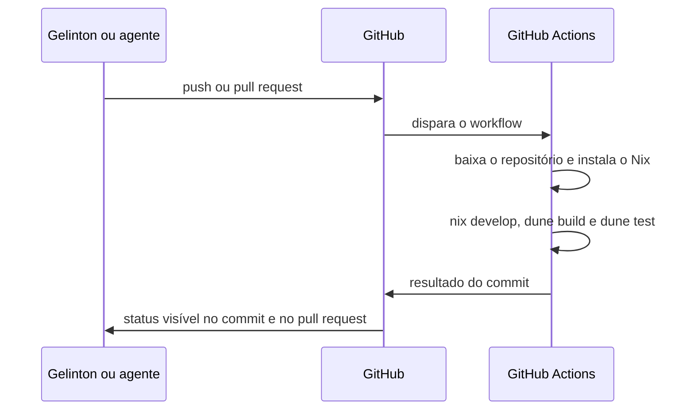
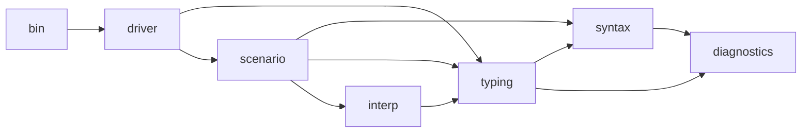
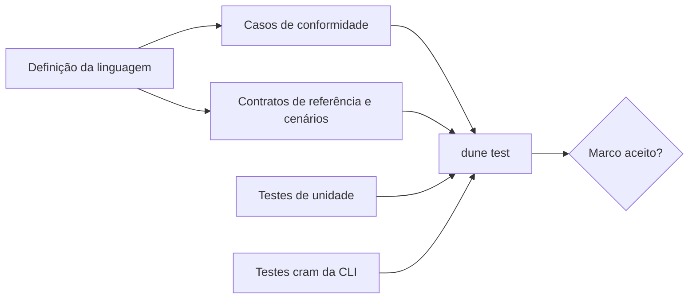
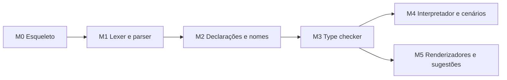

# Arquitetura da implementação do JusCore v0.1

|                             |                                                                                                                                                       |
|-----------------------------|-------------------------------------------------------------------------------------------------------------------------------------------------------|
| **Status**                  | Rascunho para discussão (`0.1-draft6`)                                                                                                                |
| **Data**                    | 2026-11-22                                                                                                                                            |
| **Responsável**             | Jefferson O. Andrade                                                                                                                                  |
| **Público**                 | Grupo Jus; agentes de IA que irão gerar o código                                                                                                      |
| **Documentos relacionados** | *JusCore v0.1 — Definição da Linguagem* (normativa para a linguagem); README do programa; *Protocolo experimental — Estudo 1* (`juscore-experiments`) |

---

## 0. Como ler este documento

A **definição da linguagem** diz *o que* o JusCore é: sintaxe, tipos, semântica e diagnósticos. Este documento diz *como* a implementação é organizada: pilha tecnológica, módulos, interfaces, linha de comando, formato de cenários, testes e plano de geração por agentes. Em caso de conflito, prevalece a definição da linguagem. O conflito deve ser registrado no Zulip e resolvido nos dois documentos.

Convenções:

- **DEVE** / **NÃO DEVE** indicam requisitos obrigatórios.
- **PODE** indica comportamento permitido, mas opcional.
- As referências do tipo "definição §N" apontam para a definição da linguagem.

Os trechos de OCaml são **esboços de interface**. Os nomes podem mudar durante a implementação, mas a divisão de responsabilidades e os tipos de dados centrais não devem mudar sem decisão registrada.

---

## 1. Terminologia

| Termo                           | Significado                                                                                                                              |
|---------------------------------|------------------------------------------------------------------------------------------------------------------------------------------|
| **Implementação do JusCore**    | Todo o software deste documento. É distribuída como a ferramenta de linha de comando `jus`                                               |
| **Front-end**                   | Lexer, parser, resolução de nomes, type checker e diagnósticos. Recebe código-fonte e produz uma AST tipada ou uma lista de diagnósticos |
| **Interpretador de referência** | Executa a AST tipada segundo a semântica normativa (definição §8). Existe desde o v0.1 e é permanente                                    |
| **Backend Michelson**           | Gera código Michelson a partir da AST tipada. Vem depois do primeiro artigo                                                              |
| **Compilador**                  | Em sentido estrito, front-end mais backend. Não é usado como sinônimo da implementação inteira                                           |

O interpretador não é um substituto provisório do backend. Ele tem três funções permanentes:

1. executar os cenários de teste, inclusive os dos contratos gerados por agentes nos experimentos;
2. servir de oráculo nos testes diferenciais contra o backend e contra a semântica mecanizada;
3. dar feedback rápido aos agentes, sem blockchain.

---

## 2. Visão geral



O fluxo tem três características importantes:

- **O front-end é a peça central.** Ele concentra a maior parte do código, e é nele que está a pergunta de pesquisa do Gelinton (os diagnósticos).
- **A AST tipada é a fronteira estável** entre o front-end e qualquer consumidor (interpretador, backend, futuras ferramentas de verificação).
- **Os diagnósticos têm uma só representação interna**, e todos os formatos de saída derivam dela (definição §10.1).

---

## 3. Pilha tecnológica

| Item              | Escolha               | Observação                                                                                                           |
|-------------------|-----------------------|----------------------------------------------------------------------------------------------------------------------|
| Linguagem         | OCaml 5               | Série fixada no `flake.nix`: 5.4, ou 5.3 se alguma dependência não compilar com a 5.4 (§3.1)                         |
| Ambiente          | Nix com flakes        | `flake.nix` e `flake.lock` no repositório (§3.1)                                                                     |
| Build             | dune                  | Inclui os testes (`dune test`)                                                                                       |
| Lexer             | ocamllex              | Trabalha em bytes, o que é coerente com as colunas em bytes da definição §10.1                                       |
| Parser            | Menhir                | Com a API incremental, para mensagens de erro com tokens esperados                                                   |
| Números           | Zarith                | Para `Nat`, `Tez` e `Timestamp`. O `int` nativo do OCaml tem 63 bits e não comporta o limite de `Tez` (2^63−1 mutez) |
| JSON              | Yojson                | Saída de diagnósticos e de AST                                                                                       |
| Linha de comando  | Cmdliner              |                                                                                                                      |
| Testes de unidade | Alcotest              |                                                                                                                      |
| Testes de saída   | testes *cram* do dune | Para congelar a saída textual da CLI                                                                                 |
| Formatação        | ocamlformat           | Configuração versionada no repositório                                                                               |

Restrições:

- A biblioteca-padrão do OCaml é a base. Bibliotecas alternativas como Core ou Base **NÃO DEVEM** ser usadas: elas aumentam a superfície que o agente precisa conhecer.
- Qualquer dependência nova exige decisão registrada.
- O código **NÃO DEVE** ter estado global mutável, com uma exceção: o coletor de diagnósticos, passado explicitamente.
- Paralelismo e efeitos do OCaml 5 (domínios, *effect handlers*) não são necessários no v0.1 e **NÃO DEVEM** ser usados sem decisão registrada. Isso protege o determinismo exigido na §7.

### 3.1 Ambiente de desenvolvimento com Nix

O ambiente é definido por dois arquivos na raiz do repositório:

| Arquivo      | Função                                                                                                         |
|--------------|----------------------------------------------------------------------------------------------------------------|
| `flake.nix`  | **Quais** pacotes compõem o ambiente (compilador, bibliotecas e ferramentas) e **qual** série do OCaml é usada |
| `flake.lock` | **Qual revisão** do nixpkgs fornece esses pacotes. É gerado pelo Nix e fixa as versões exatas                  |

Uso:

```sh
# entrar no ambiente
nix develop

# rodar um comando dentro do ambiente, sem abrir um shell
nix develop --command dune test

# atualizar a revisão do nixpkgs (só por decisão registrada)
nix flake update
```

**Versão do OCaml.** O `flake.nix` usa explicitamente `ocaml-ng.ocamlPackages_5_4`, e não o atalho `ocamlPackages`. O atalho aponta para versões diferentes ao longo do tempo, e uma atualização do `flake.lock` trocaria o compilador sem ninguém perceber. Se alguma das dependências não compilar com a 5.4 na revisão fixada, troca-se para `ocamlPackages_5_3`. Isso será resolvido no M0.

**Ramo do nixpkgs.** Usa-se o ramo estável mais recente no momento da criação do repositório, que tem mais pacotes no cache binário e muda menos que o `nixpkgs-unstable`.

**Instalação do Nix.** O Nix roda em Linux, macOS e WSL2. Na instalação padrão, os flakes ainda dependem de uma opção. É preciso incluir esta linha em `~/.config/nix/nix.conf`:

```text
experimental-features = nix-command flakes
```

**Opcional: direnv.** Com `direnv` e `nix-direnv`, um arquivo `.envrc` contendo `use flake` ativa o ambiente automaticamente ao entrar no diretório.

**Agentes.** Os agentes de geração rodam dentro do mesmo ambiente: a ferramenta do agente é iniciada a partir de `nix develop`. Assim, `dune build` e `dune test` dão o mesmo resultado para o agente, para o humano e para a CI.

**Plano B.** Quem não puder usar Nix pode usar o opam com as mesmas versões das bibliotecas, sem garantia de reprodutibilidade idêntica.

### 3.2 Integração contínua

**O que é.** A cada `push` ou *pull request*, um serviço externo baixa o repositório, monta o ambiente, roda `dune build` e `dune test`, e publica o resultado (verde ou vermelho) ao lado do commit no GitHub. Isso garante que nada entra no ramo principal quebrando a suíte de aceitação, venha o código de um agente ou de um humano.



**Plataforma.** Os repositórios ficam no GitHub, na organização `jus-lang`. Até 2026-11-22 estavam no Codeberg, mas os termos de uso do Codeberg, desde julho de 2026, não admitem projetos compostos majoritariamente de código escrito por ferramentas de IA generativa. É exatamente o caso planejado para o `juscore` (§11). A CI usa o GitHub Actions, que dispensa pedido de acesso e é gratuito para repositórios públicos nos executores padrão.

**Mesmo ambiente na CI.** O workflow instala o Nix e usa o mesmo `flake.nix` e o mesmo `flake.lock` do desenvolvimento:

```yaml
# .github/workflows/ci.yml
name: CI

on:
  push:
    branches: [main]
  pull_request:

permissions:
  contents: read

jobs:
  build-and-test:
    runs-on: ubuntu-latest
    steps:
      - uses: actions/checkout@v5
      - uses: cachix/install-nix-action@v31
        with:
          github_access_token: ${{ secrets.GITHUB_TOKEN }}
      - run: nix develop --command dune build
      - run: nix develop --command dune test
```

O `install-nix-action` já habilita flakes. O `github_access_token` evita o limite de requisições anônimas ao GitHub quando o Nix baixa as entradas do flake. As versões das *actions* são mantidas pelo Dependabot:

```yaml
# .github/dependabot.yml
version: 2
updates:
  - package-ecosystem: github-actions
    directory: /
    schedule:
      interval: monthly
```

A cada execução, o Nix baixa os pacotes do cache binário do NixOS. Para um projeto deste tamanho, isso basta. Se o tempo de CI incomodar, a evolução natural é guardar o *store* do Nix no cache do GitHub Actions (por exemplo, com `nix-community/cache-nix-action`) ou usar um cache Cachix.

**Proteção dos testes de conformidade.** O GitHub permite transformar em regra a primeira instrução do `AGENTS.md` (§11.4): agentes não alteram `test/conformance/` nem `test/contracts/` sem aprovação humana. Duas peças fazem isso:

1. um arquivo `.github/CODEOWNERS` atribui esses diretórios ao Jefferson e ao Gelinton:

   ```text
   # .github/CODEOWNERS
   /test/conformance/  @<usuário-jefferson> @<usuário-gelinton>
   /test/contracts/    @<usuário-jefferson> @<usuário-gelinton>
   ```

2. uma regra (*ruleset*) para o ramo `main` exige:
   - *pull request* para qualquer mudança;
   - CI verde (`build-and-test`);
   - revisão de um *code owner* quando o *pull request* toca os diretórios acima.

Mudanças fora desses diretórios continuam precisando só da CI verde. O Jefferson, como administrador, pode contornar a regra em emergências.

O GitHub não deixa o autor de um *pull request* aprová-lo. Se os agentes trabalharem com a conta do Gelinton, a aprovação de mudanças nos testes cabe ao Jefferson, o que pesa durante a viagem. A configuração exata é decidida no M0, quando a regra for ativada junto com o primeiro workflow.

---

## 4. Estrutura do repositório

Proposta (os caminhos podem ser ajustados):

```text
juscore/
├── AGENTS.md                  instruções para agentes (§11.4)
├── flake.nix                  ambiente de desenvolvimento (§3.1)
├── flake.lock                 revisão fixada do nixpkgs (§3.1)
├── .github/
│   ├── workflows/ci.yml       integração contínua (§3.2)
│   ├── dependabot.yml         atualização das actions (§3.2)
│   └── CODEOWNERS             revisão obrigatória dos testes de conformidade (§3.2)
├── dune-project
├── bin/
│   └── main.ml                CLI (Cmdliner)
├── lib/
│   ├── syntax/                loc.ml, ast.ml, lexer.mll, parser.mly, parse.ml
│   ├── diagnostics/           code.ml, diagnostic.ml, collector.ml, render_*.ml
│   ├── typing/                types.ml, env.ml, declare.ml, typecheck.ml, tast.ml
│   ├── interp/                value.ml, builtins.ml, eval.ml, ledger.ml
│   ├── scenario/              scenario_ast.ml, scenario_parser.mly, runner.ml
│   └── driver/                pipeline.ml
├── test/
│   ├── unit/                  testes Alcotest
│   ├── conformance/           casos .jus com expectativas (§9.2)
│   ├── contracts/             contratos de referência e cenários (§9.3)
│   └── cli/                   testes cram da saída textual (§9.4)
├── docs/                      definição da linguagem, esta arquitetura, referência para agentes
│   └── legacy/                contratos e gramática do protótipo Java, para referência histórica
└── agent-log/                 registro das sessões de geração (§11.3)
```

Dependências entre as bibliotecas:



Nenhuma biblioteca pode depender de `driver` ou `bin`. `interp` não pode depender de `scenario`. Isso mantém o interpretador utilizável por outros consumidores, como futuros testes diferenciais.

---

## 5. Front-end

### 5.1 Localizações (`syntax/loc.ml`)

```ocaml
type pos  = { line : int; col : int }                   (* a partir de 1; col em bytes *)
type span = { file : string; start : pos; stop : pos }  (* stop exclusivo *)
val merge : span -> span -> span
```

Todo nó da AST, todo tipo escrito pelo usuário e toda cláusula de especificação carregam um `span`.

### 5.2 Lexer (`syntax/lexer.mll`)

- Implementa a definição §3.
- Produz os tokens de Menhir com o seu `span`.
- Erros: E001–E005. Diante de um erro léxico, o lexer reporta o diagnóstico e interrompe a análise do arquivo.
- Literais de tez são convertidos para mutez (`Z.t`) já no lexer. Estouro de 2^63−1 gera E004.

### 5.3 Parser (`syntax/parser.mly`, `syntax/parse.ml`)

- Implementa a gramática da definição §4. A gramática Menhir **DEVE** estar livre de conflitos; a compilação usa `--explain` e falha se houver conflito.
- Usa a API incremental de Menhir. Num erro de sintaxe, o diagnóstico E101 lista os tokens esperados no estado corrente. Um arquivo de mensagens de erro do Menhir (`parser.messages`) PODE ser usado para mensagens mais específicas, como E102 para `end` ausente.
- **Recuperação:** no v0.1, o parser para no primeiro erro de sintaxe. Se houver erro de sintaxe, as fases seguintes não rodam (ver definição §10.2).
- Ponto de entrada: `val parse_program : file:string -> string -> (Ast.program, Diagnostic.t list) result`.

### 5.4 AST (`syntax/ast.ml`)

A AST espelha a gramática, sem nenhuma informação de tipo:

```ocaml
type ident = { name : string; span : Loc.span }

type ty = { tdesc : ty_desc; tspan : Loc.span }
and ty_desc = TName of ident * ty list                 (* Nat, List[Address], ... *)

type literal =
  | LBool of bool | LNat of Z.t | LTez of Z.t (* mutez *)
  | LString of string | LAddress of string

type binop = Add | Sub | Mul | Div | Mod
           | Eq | Neq | Lt | Le | Gt | Ge | And | Or

type expr = { edesc : expr_desc; espan : Loc.span }
and expr_desc =
  | Lit of literal
  | Var of ident
  | Call of ident * expr list                          (* def, transfer, fail *)
  | ModCall of ident * ident * expr list               (* List.length(xs) *)
  | Ctor of ident * expr list                          (* Claimed, Some(x) *)
  | Field of expr * ident
  | RecordLit of (ident * expr) list
  | RecordUpdate of expr * (ident * expr) list
  | ListLit of expr list
  | Annot of expr * ty
  | Let of ident * ty option * expr * expr
  | If of expr * expr * expr
  | Match of expr * arm list
  | Binop of binop * expr * expr
  | Not of expr
and arm = { pat : pattern; body : expr; aspan : Loc.span }
and pattern = PWild of Loc.span | PCtor of ident * subpat list
and subpat  = SWild of Loc.span | SVar of ident

type spec = { kind : [ `Requires | `Ensures ]; cond : expr; sspan : Loc.span }
type field = { fname : ident; fty : ty }
type param = { pname : ident; pty : ty }
type ctor  = { cname : ident; cfields : field list }

type decl =
  | Struct    of { name : ident; fields : field list; span : Loc.span }
  | Inductive of { name : ident; ctors : ctor list; span : Loc.span }
  | Def       of { name : ident; params : param list; ret : ty;
                   specs : spec list; body : expr; span : Loc.span }
  | Entry     of { name : ident; params : param list;
                   specs : spec list; body : expr; span : Loc.span }

type program = { contract : ident; decls : decl list }
```

Requisitos:

- As cláusulas `specs` **DEVEM** ser preservadas na ordem em que aparecem, com seus spans (definição §7.4).
- O parser não decide se `Call` se refere a um def ou a um built-in, nem se `Ctor` se refere a um construtor do usuário ou a `Some`/`None`. Isso é trabalho da resolução de nomes.
- O comando `jus ast --json` (§7) serializa essa estrutura.

### 5.5 Diagnósticos (`diagnostics/`)

```ocaml
(* code.ml — fonte única do catálogo da definição §10.3 e §10.4 *)
type t = E001 | E002 | (* ... *) | W603 | R001 | (* ... *) | R007
val to_string : t -> string               (* "E301" *)
val severity  : t -> [ `Error | `Warning ]
val explanation : t -> string             (* texto fixo por código, usado pela variante D3 do protocolo *)
val all       : t list                    (* usado em teste de completude *)

(* diagnostic.ml — registro interno da definição §10.1 *)
type edit    = { span : Loc.span; text : string }
type fix     = { description : string; edits : edit list }
type related = { rspan : Loc.span; rmessage : string }
type t = {
  code : Code.t; message : string; span : Loc.span;
  expected : string option; found : string option;
  notes : string list; related : related list; fixes : fix list;
}

(* collector.ml — acumula diagnósticos de uma execução *)
type c
val create : unit -> c
val report : c -> Diagnostic.t -> unit
val to_list : c -> Diagnostic.t list       (* ordenados por arquivo, linha, coluna, código *)

(* render.ml — registro de renderizadores *)
type renderer = { name : string;
                  render : sources:(string -> string option) -> Diagnostic.t list -> string }
val register : renderer -> unit
val find : string -> renderer option
```

Requisitos:

- `Code` é a única fonte dos códigos. Um teste de unidade **DEVE** verificar que todos os códigos da definição §10.3 e §10.4 existem em `Code.all`, e só eles.
- **Renderizadores obrigatórios:**
  - `human`, no formato exemplificado na definição §11.4;
  - `json`, como uma lista de objetos no formato da definição §10.5.
- **Variantes experimentais:** registradas pelo mesmo mecanismo. Os nomes e o conteúdo de cada variante serão definidos no protocolo experimental. Uma variante só pode **omitir ou reapresentar** informação do registro interno; ela **NÃO DEVE** consultar a AST nem recalcular nada.
- **Sugestões** como "did you mean 'owner'?" são geradas no momento em que o diagnóstico é criado e ficam guardadas no registro, como `notes` ou `fixes`. A semelhança de nomes é medida pela distância de edição, com limite de 2 para nomes de até 8 caracteres e de 3 acima disso.

### 5.6 Tipos e ambiente (`typing/types.ml`, `typing/env.ml`)

```ocaml
type ty =
  | TBool | TNat | TTez | TString | TAddress | TTimestamp | TOperation
  | TOption of ty | TList of ty | TMap of ty * ty
  | TStruct of string | TInductive of string
  | TContext | TResult
  | TError                                    (* veneno, ver abaixo *)

val equal : ty -> ty -> bool                  (* TError é igual a qualquer tipo *)
val has_equality : Env.t -> ty -> bool        (* definição §5.4 *)
val has_order : ty -> bool
val to_string : ty -> string                  (* na sintaxe JusCore: "Map[Address, Bool]" *)
```

**Tipo veneno (`TError`).** Quando uma subexpressão tem erro, o type checker atribui a ela `TError` e segue em frente. Qualquer checagem que envolva `TError` passa sem gerar novos diagnósticos. É assim que se suprimem os erros em cascata exigidos pela definição §10.2.

`Env.t` reúne as declarações globais (structures, inductives com seus construtores, defs e entries) e o escopo local (variáveis e seus tipos).

### 5.7 Resolução de nomes e declarações (`typing/declare.ml`)

Fases, nesta ordem:

1. **Coleta** das declarações globais. Gera E205, E206, E501, E502 e E103 (este, quando o parser já não o tiver reportado).
2. **Boa formação dos tipos escritos:**
   - nomes desconhecidos geram E202;
   - aridade errada de construtor de tipo gera E303;
   - chave de `Map` sem igualdade gera E304;
   - `Operation` em `Storage`, e `Context`/`Result` em lugares proibidos, geram E504.
3. **Tipos recursivos:** ciclos no grafo "tipo usa tipo" geram E311.
4. **Grafo de chamadas** entre defs: ciclos geram E309. A mensagem mostra o ciclo, como `f -> g -> f`.

Os erros de nomes dentro de expressões (E201, E203, E204, E207–E211) são detectados durante a checagem de tipos, que percorre as expressões de qualquer forma.

### 5.8 Type checker (`typing/typecheck.ml`)

- Implementa as regras bidirecionais da definição §6.3 a §6.7.
- **Interface:**

  ```ocaml
  val check_program : Collector.c -> Ast.program -> Tast.program option
  (* None se houver algum erro; os avisos não impedem o resultado *)

  (* internas *)
  val synth : Collector.c -> Env.t -> ctx -> Ast.expr -> Tast.expr
  val check : Collector.c -> Env.t -> ctx -> Ast.expr -> Types.ty -> Tast.expr
  ```

  `ctx` registra onde a expressão está: corpo de def, corpo de entry, `requires` ou `ensures`. Isso permite aplicar E208, E209 e E601.
- **Built-ins** ficam numa tabela única (`typing/builtins_sig.ml`) com a assinatura de cada um, se é polimórfico, se só vale no modo check e se só vale em especificações. Essa tabela é a fonte das regras da definição §9.
- **Exaustividade e redundância de `match`** (E401, W402) são checadas por um módulo próprio, com teste de unidade dedicado.
- **Avisos de especificação** (W602, W603) são emitidos aqui.

### 5.9 AST tipada (`typing/tast.ml`)

Tem a mesma forma da AST, com três diferenças:

- cada expressão leva o seu tipo (`ety : Types.ty`, nunca `TError` num programa aceito);
- as referências são resolvidas: `Var` aponta para um local ou para um parâmetro implícito (`storage`, `ctx`, `result`); `Call` aponta para um def ou um built-in; `Ctor` aponta para um construtor do usuário ou para `Some`/`None`;
- as operações aritméticas e as comparações já indicam qual combinação da tabela da definição §6.6 se aplica, para que o interpretador não precise redescobri-la.

A AST tipada é a **interface estável** com os consumidores. Mudanças nela exigem decisão registrada.

---

## 6. Interpretador de referência

### 6.1 Valores (`interp/value.ml`)

```ocaml
type value =
  | VBool of bool | VNat of Z.t | VTez of Z.t | VString of string
  | VAddress of string | VTimestamp of Z.t
  | VOption of value option | VList of value list
  | VMap of value VMap.t                       (* mapa ordenado pela chave *)
  | VRecord of (string * value) list           (* campos na ordem da declaração *)
  | VCtor of string * value list
  | VOp of operation
and operation = Transfer of { dest : string; amount : Z.t }

val compare : value -> value -> int            (* só para tipos com igualdade ou ordem *)
val to_string : value -> string                (* na sintaxe de literais JusCore *)
```

### 6.2 Avaliação (`interp/eval.ml`)

- Implementa a definição §8.2 e §8.3.
- Um abort é representado por uma exceção que carrega o código R, a mensagem, o span e os detalhes exigidos pela definição §10.4:

  ```ocaml
  exception Abort of { code : Code.t; message : string; span : Loc.span;
                       details : (string * string) list }
  val eval_entry : Tast.program -> entry:string -> storage:value -> ctx:value
                   -> args:value list -> value  (* um Result *)
  ```

- Os built-ins ficam em `interp/builtins.ml`, com uma função por built-in, cada uma testada contra a tabela da definição §9.
- A aritmética de `Tez` checa o limite de 2^63−1 em toda operação que possa ultrapassá-lo (R007).

### 6.3 Ledger e transações (`interp/ledger.ml`)

- Implementa a semântica de transação da definição §8.4.
- O estado é imutável: uma chamada recebe o ledger e devolve um novo ledger ou um abort. A reversão total em caso de falha sai de graça, porque basta descartar o resultado.
- Endereços externos têm saldo ilimitado. O ledger registra quanto cada endereço recebeu, para as asserções dos cenários.

---

## 7. Linha de comando

```text
jus check <arquivo.jus> [--diagnostics=<nome>]
jus run   <arquivo.scenario> [--diagnostics=<nome>] [--format=human|json]
jus ast   <arquivo.jus> [--typed] --json
jus diagnostics --list
jus version
```

| Comando              | Função                                                                                         |
|----------------------|------------------------------------------------------------------------------------------------|
| `check`              | Roda o front-end e imprime os diagnósticos no renderizador escolhido (padrão: `human`)         |
| `run`                | Checa o contrato referenciado pelo cenário, executa as chamadas e verifica as expectativas     |
| `ast`                | Serializa a AST (ou a AST tipada, com `--typed`) em JSON                                       |
| `diagnostics --list` | Lista os renderizadores registrados, incluindo as variantes experimentais                      |
| `version`            | Mostra a versão da ferramenta e as versões da definição e desta arquitetura que ela implementa |

**Códigos de saída:**

| Código | Significado                                  |
|--------|----------------------------------------------|
| 0      | Sucesso, sem erros (pode haver avisos)       |
| 1      | Erros de compilação                          |
| 2      | Pelo menos uma expectativa de cenário falhou |
| 3      | Erro de uso ou erro interno                  |

**Saída determinística:** a mesma entrada **DEVE** produzir a mesma saída, byte a byte. Os diagnósticos saem ordenados; não há horários nem caminhos absolutos na saída. Isso é necessário para os testes *cram* e para a reprodutibilidade dos experimentos.

---

## 8. Formato de cenários

Esta seção responde à questão Q3 da definição: os cenários usam **literais e expressões do próprio JusCore**, dentro de uma estrutura simples. Para não reservar palavras que colidam com nomes de campos (como `amount` ou `storage`), o formato acrescenta só seis palavras-chave e reaproveita a sintaxe de registros para o contexto de cada chamada.

### 8.1 Exemplo

```text
scenario "owner withdraws after unlock"
contract "timelock_vault.jus"
set self    @KT1Vault
set storage { owner := @tz1Owner,
              unlockTime := Timestamp.fromSeconds(1000),
              state := Locked }

call deposit() with { sender := @tz1Alice, amount := 5tz, time := 500 }
expect succeeds
expect balance == 5tz

call withdraw() with { sender := @tz1Bob, amount := 0mutez, time := 2000 }
expect fails R001

call withdraw() with { sender := @tz1Owner, amount := 0mutez, time := 2000 }
expect succeeds
expect storage.state == Claimed
expect Ops.sentTo(lastOps, @tz1Owner) == 5tz
expect balance == 0mutez
```

### 8.2 Gramática

```ebnf
scenarioFile ::= "scenario" STRING "contract" STRING setting* step* EOF
setting      ::= "set" LIDENT expr          -- LIDENT: self, balance ou storage
step         ::= "call" LIDENT "(" [ args ] ")" "with" expr expectation*
expectation  ::= "expect" "succeeds"
               | "expect" "fails" RCODE [ STRING ]
               | "expect" expr
```

Os não terminais `expr` e `args` são os da definição §4.3, e os tokens são os da definição §3. O formato acrescenta:

- as palavras-chave `scenario`, `set`, `call`, `expect`, `succeeds` e `fails`;
- o token `RCODE`, de forma `R` seguido de três dígitos.

`contract` e `with` já são palavras-chave do JusCore.

### 8.3 Significado

| Elemento                  | Significado                                                                                                                                                                                                                                          |
|---------------------------|------------------------------------------------------------------------------------------------------------------------------------------------------------------------------------------------------------------------------------------------------|
| `contract`                | Caminho do contrato, relativo ao arquivo de cenário. Se o contrato tiver erros de compilação, o cenário não roda e `jus run` termina com código 1                                                                                                    |
| `set self`                | Endereço do contrato (padrão: `@KT1Self`)                                                                                                                                                                                                            |
| `set balance`             | Saldo inicial do contrato, do tipo `Tez` (padrão: `0mutez`)                                                                                                                                                                                          |
| `set storage`             | Obrigatório. Expressão checada contra o tipo `Storage` do contrato e avaliada sem `storage`, `ctx` nem `result`                                                                                                                                      |
| `call e(args) with r`     | Executa uma transação (definição §8.4). Os argumentos são checados contra os parâmetros do entry. `r` é checado contra o registro embutido `CallContext`, com os campos `sender : Address`, `amount : Tez` e `time : Nat` (segundos; vira `ctx.now`) |
| `expect succeeds`         | A última chamada terminou sem abort                                                                                                                                                                                                                  |
| `expect fails Rnnn [msg]` | A última chamada abortou com esse código e, se a mensagem for dada, com essa mensagem                                                                                                                                                                |
| `expect e`                | `e` é checada contra `Bool` e deve dar `true`                                                                                                                                                                                                        |

**Ambiente das expressões em `expect e`:**

- `storage` — o storage **depois** da última chamada;
- `balance` — o saldo atual do contrato;
- `lastOps` — as operações emitidas pela última chamada (vazia se ela falhou);
- `received(a)` — o total recebido pelo endereço `a` desde o início do cenário.

As funções `Ops.*` são permitidas nessas expressões. Uma expectativa sem chamada anterior é erro de cenário.

Restrições:

- os erros de tipo em cenários usam os mesmos códigos da definição §10.3, com o span apontando para o arquivo de cenário;
- `CallContext`, `lastOps` e `received` só existem em cenários;
- como `succeeds` e `fails` são palavras-chave, o built-in `fail` não pode ser usado em expressões de cenário.

**Saída:** para cada expectativa, `ok` ou `FAILED`, com o valor obtido e o esperado. Um resumo final informa quantas expectativas passaram e quantas falharam. Com `--format=json`, a mesma informação sai em JSON.

---

## 9. Testes e critérios de aceitação

A suíte de testes é o **critério de aceitação** do código gerado por agentes. Segue o mesmo princípio de autoridade humana do programa: os testes de conformidade derivam da definição da linguagem, são revisados por um humano e **NÃO DEVEM** ser alterados por agentes sem aprovação (§11.4).

### 9.1 Visão geral



### 9.2 Casos de conformidade (`test/conformance/`)

Cada caso é um arquivo `.jus` pequeno. As expectativas ficam em comentários no início do arquivo:

```text
-- expect: E301 3:25
-- expect: W602 5:12
contract C
...
```

- Cada linha `-- expect:` dá um código e a posição **inicial** (linha:coluna) de um diagnóstico.
- `-- expect: ok` indica que não deve haver nenhum diagnóstico.
- **Casos de execução** (códigos R) ficam em `test/conformance/runtime/`. Cada caso é um contrato mínimo com um cenário, e o cenário usa `expect fails Rnnn`.

O executor dos testes compara o **conjunto** de pares (código, posição) produzido com o esperado. As mensagens não são comparadas, para que possam variar entre renderizadores e versões.

A primeira versão da suíte **DEVE** cobrir:

- todos os códigos da definição §10.3 e §10.4, com pelo menos um caso positivo cada;
- todos os casos da tabela da definição §11.5.

### 9.3 Contratos de referência (`test/contracts/`)

- Os três contratos da definição §11, exatamente como estão lá, devem passar por `jus check` sem nenhum diagnóstico.
- Cada contrato terá pelo menos um cenário para cada um destes casos:
  - caminho feliz;
  - violação de cada `requires` de autorização;
  - estado errado;
  - valor errado.
- As **variantes de segurança** da definição §11.4 ficam aqui como contratos à parte, com cenários que mostram o comportamento indevido. Por exemplo: um cenário em que um endereço que não é o dono esvazia o vault na variante sem guarda.

### 9.4 Testes de unidade e de CLI

- **Unidade** (`test/unit/`):
  - lexer, com literais e limites de tez;
  - aritmética e limites (R004, R005, R007);
  - ordem de `VMap`;
  - exaustividade de `match`;
  - completude de `Code.all`;
  - distância de edição das sugestões.
- **CLI** (`test/cli/`): testes *cram* que congelam a saída do renderizador `human` para alguns casos. Mudar o formato exige atualizar esses testes, o que fica visível na revisão.

---

## 10. Ponto de encaixe do backend (informativo)

O backend Michelson virá depois do primeiro artigo. Para não bloqueá-lo:

- ele ficará em `lib/backend/michelson/` e consumirá **somente** a AST tipada;
- a representação intermediária, se houver, será definida junto com o backend (OPEN no README);
- os **testes diferenciais** rodarão os mesmos cenários no interpretador e no Michelson gerado, e compararão o storage final, as operações emitidas e os aborts. Para executar Michelson fora da blockchain, deve-se avaliar o modo *mockup* do `octez-client` ou um interpretador de Michelson;
- nada no v0.1 deve depender da existência do backend.

---

## 11. Plano de geração por agentes

### 11.1 Marcos



| Marco                             | Escopo                                                                                                                                                                                                                           | Critério de aceitação                                                                           |
|-----------------------------------|----------------------------------------------------------------------------------------------------------------------------------------------------------------------------------------------------------------------------------|-------------------------------------------------------------------------------------------------|
| **M0** Esqueleto                  | `flake.nix` com a série do OCaml confirmada, `flake.lock`, CI, `dune-project`, bibliotecas vazias com interfaces (`.mli`) da §5 e §6, CLI com `version` e `diagnostics --list`, `Loc`, `Code`, `Diagnostic`, renderizador `json` | `dune build` e `dune test` passam; teste de completude de `Code.all` passa                      |
| **M1** Lexer e parser             | §5.2 a §5.4; `jus ast --json`                                                                                                                                                                                                    | Os três contratos de referência fazem parsing; casos de conformidade E0xx e E1xx passam         |
| **M2** Declarações e nomes        | §5.7; erros de nomes em expressões                                                                                                                                                                                               | Casos E2xx, E5xx, E309 e E311 passam                                                            |
| **M3** Type checker               | §5.8 e §5.9                                                                                                                                                                                                                      | Casos E3xx, E4xx, E6xx e W passam; os três contratos de referência são aceitos sem diagnósticos |
| **M4** Interpretador e cenários   | §6 e §8; `jus run`                                                                                                                                                                                                               | Casos R passam; todos os cenários de `test/contracts/` passam                                   |
| **M5** Renderizadores e sugestões | renderizador `human`, sugestões e correções (§5.5), variantes do protocolo                                                                                                                                                       | Testes cram passam; exemplos da definição §10.5 e §11.4 reproduzidos                            |

O M5 pode andar em paralelo com o M4. As variantes experimentais dependem do protocolo experimental.

**Piloto para a WorldCIST (opcional):** se houver tempo até 2026-12-06, M0 a M3 restritos a um subconjunto pequeno de erros de tipo bastam para um piloto com poucas tarefas.

### 11.2 Fluxo de trabalho de cada marco

1. **Testes primeiro.** O humano (Gelinton) escreve ou revisa os casos de conformidade e os cenários do marco, derivados da definição. Um agente pode propor esses casos, mas eles só entram com aprovação humana.
2. **Geração.** O agente recebe a definição da linguagem, este documento, o `AGENTS.md` e a descrição do marco, e implementa até que `dune build` e `dune test` passem.
3. **Revisão.** O humano revisa o código, sobretudo os pontos em que o agente possa ter contornado um teste em vez de resolver o problema.
4. **Registro.** A sessão é registrada no `agent-log/` (§11.3) e o marco é fechado com um commit identificado (`M3: type checker`).
5. **Divergências.** Se o agente encontrar uma ambiguidade na definição, ele a reporta. A definição é corrigida por decisão registrada; o agente **NÃO DEVE** resolvê-la por conta própria.

### 11.3 Registro das sessões (`agent-log/`)

Cada sessão de geração tem um arquivo `agent-log/AAAA-MM-DD-Mn-k.md` com:

- data, marco e objetivo;
- ferramenta e modelo, com versão exata (ex.: o agente de linha de comando usado e o identificador do modelo);
- documentos e prompts fornecidos (os prompts ficam copiados no arquivo ou anexados);
- resultado: testes que passaram e falharam, e número de iterações;
- intervenções humanas e problemas encontrados;
- custo ou consumo, se a ferramenta informar.

Esse registro serve à reprodutibilidade e é material direto para a dissertação e os artigos.

### 11.4 Conteúdo mínimo do `AGENTS.md`

```text
# Instruções para agentes

Leia antes de qualquer alteração:
- docs/juscore-language-definition.md (normativo para a linguagem)
- docs/juscore-architecture.md (normativo para a implementação)

Regras:
1. Não altere arquivos em test/conformance/ nem em test/contracts/ sem
   aprovação explícita. Se um teste parecer errado, explique o motivo e pare.
2. Não adicione dependências (pacotes em flake.nix ou bibliotecas em
   arquivos dune) sem aprovação.
3. Trabalhe dentro do ambiente do projeto (nix develop).
4. Respeite as dependências entre bibliotecas da seção 4 da arquitetura.
5. Não use estado global mutável, exceto o coletor de diagnósticos.
6. Todo diagnóstico usa um código de lib/diagnostics/code.ml; não invente
   códigos. Se faltar um, pare e reporte.
7. Antes de concluir, rode `dune build` e `dune test` e informe o resultado.
8. Se encontrar ambiguidade na definição da linguagem, não decida sozinho:
   descreva a ambiguidade e as alternativas.
```

---

## 12. Questões abertas e decisões

| #  | Questão                                                       | Situação                                                                                                                                                                                                                                                                                                                  |
|----|---------------------------------------------------------------|---------------------------------------------------------------------------------------------------------------------------------------------------------------------------------------------------------------------------------------------------------------------------------------------------------------------------|
| A1 | Onde fica o repositório da implementação                      | **Decidido:** `github.com/jus-lang/juscore`, um único repositório para toda a implementação (front-end, interpretador e, depois, backend), com os documentos normativos em `docs/`. O repositório `jus-lang/interpreter` é arquivado como legado (§13). Os repositórios migraram do Codeberg para o GitHub em 2026-11-22 (§3.2). A organização geral dos repositórios está no README do programa |
| A2 | Versão exata do OCaml e das dependências                      | **Decidido:** OCaml 5, com o ambiente em Nix com flakes; versões fixadas pelo `flake.lock` (§3.1)                                                                                                                                                                                                                         |
| A3 | Integração contínua                                           | **Decidido:** GitHub Actions com `cachix/install-nix-action` e o mesmo flake (§3.2); ruleset e CODEOWNERS protegem `main` e os testes de conformidade |
| A4 | Ferramenta de agente usada na geração                         | A decidir na reunião com o Gelinton (terça-feira, 2026-11-24)                                                                                                                                                                                                                                                             |
| A5 | Executar Michelson fora da blockchain nos testes diferenciais | **Decidido:** avaliar quando o backend começar                                                                                                                                                                                                                                                                            |
| A6 | Recuperação de erros de sintaxe                               | **Decidido:** depois do v0.1, se os experimentos mostrarem que importa                                                                                                                                                                                                                                                    |
| A7 | Sistema operacional de cada participante                      | O Nix roda em Linux, macOS e WSL2; confirmar o sistema do Gelinton só para as instruções de instalação                                                                                                                                                                                                                    |
| A8 | OCaml 5.4 ou 5.3                                              | **Decidido:** 5.4. Testado em 2026-11-22: `nix develop` montou o ambiente com OCaml 5.4.1 e dune 3.21.1                                                                                                                                                                                                                   |

---

## 13. Protótipo legado em Java

Análise do snapshot de `jus-lang/interpreter` feita em 2026-11-22, quando o repositório ainda estava no Codeberg. Houve outra versão do interpretador, criada para um projeto específico, que se perdeu. Esse snapshot é a única versão disponível, e é a ela que esta seção se refere.

**O que existe:**

- projeto Maven (Java 11 ou superior) com ANTLR 4.13.1;
- cerca de 900 linhas de Java, das quais 650 no *visitor* principal;
- gramática `Jus.g4` da sintaxe antiga;
- dois contratos de exemplo (Escrow e TimeLockVault, os mesmos do trabalho de 2025);
- quatro scripts de teste manual.

**Estado de funcionamento:**

- **Nada é executado.** O programa principal faz o parsing e percorre as declarações, registrando-as e imprimindo um log. Nenhuma função ou transição é chamada: o método que dispara eventos existe, mas não é usado. Também não há sintaxe para construir valores de `structure`, então funções que recebem registros não poderiam ser chamadas.
- **Literais booleanos não funcionam.** Na versão atual da gramática, `true` e `false` são reconhecidos como identificadores, porque a regra de identificador vem antes da regra de literal booleano. As expressões `if (...) then true else false` dos exemplos avaliariam para um identificador indefinido.
- **Erros de sintaxe não interrompem a execução.** O ANTLR reporta e segue, e o programa não verifica se houve erro.
- **Não há checagem estática de tipos** nem testes automatizados (o diretório de testes está vazio).
- **`Nat` usa inteiros de 32 bits** do Java.
- **O executável compilado está desatualizado.** O `.jar` no diretório `target/` foi gerado a partir do primeiro rascunho da gramática, antes das mudanças posteriores.

**Diferença em relação ao JusCore.** A sintaxe antiga:

- depende de indentação;
- reserva os nomes `State` e `Event`, o que permite um único tipo de estado por contrato;
- tem uma forma especial `def transition`;
- não tem aritmética, operadores booleanos, `let` nem literais de registro.

Praticamente nenhuma decisão de design coincide com a definição do JusCore v0.1.

**Recomendação:**

- não reaproveitar código;
- arquivar o repositório, o que preserva o histórico e a autoria da Larissa (feito no Codeberg em 2026-11-22; o repositório migra arquivado para o GitHub);
- acrescentar ao README do repositório antigo um aviso apontando para o novo;
- copiar a gramática e os dois contratos para `docs/legacy/` do novo repositório, como referência histórica e como origem dos casos motivadores (definição §11.4).

---

## Histórico

- `0.1-draft1` (2026-11-22): primeira versão completa para discussão.
- `0.1-draft2` (2026-11-22): ambiente com GNU Guix e OCaml 4.14 (§3.1); integração contínua (§3.2); questões A1–A7 atualizadas (§12); análise do protótipo legado em Java (§13).
- `0.1-draft3` (2026-11-22): Guix substituído por Nix com flakes, com OCaml 5 (§3.1); CI com imagem do Nix (§3.2); A1 decidida (um repositório para toda a implementação); nova questão A8.
- `0.1-draft4` (2026-11-22): A8 decidida (OCaml 5.4); `Code.explanation` acrescentado para a variante D3 do protocolo experimental.
- `0.1-draft5` (2026-11-22): caminhos dos documentos corrigidos no `AGENTS.md` (§11.4); registro de que outra versão do interpretador, usada num projeto específico, se perdeu (§13).
- `0.1-draft6` (2026-11-22): repositórios migrados do Codeberg para o GitHub; CI no GitHub Actions, com Dependabot, CODEOWNERS e ruleset para os testes de conformidade (§3.2, §4); A1 e A3 atualizadas (§12).
